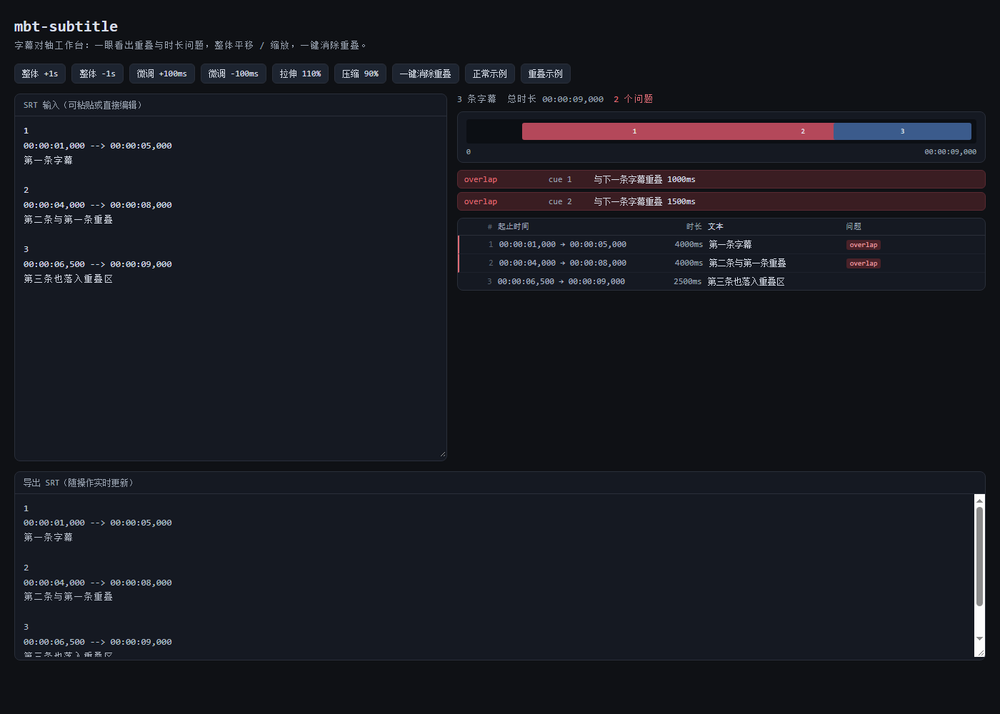

# mbt-subtitle

纯 MoonBit 实现的 SRT / WebVTT 字幕工具：**解析、序列化、整体平移与缩放、重叠与时长检查**，提供可复用库、CLI 与 Web GUI。



## 特性

- **双格式**：SRT 与 WebVTT 解析 / 序列化，支持 BOM、CRLF、多行文本
- **时间轴调整**：整体平移（`+1.5s` / `-500ms`）与按百分比缩放
- **一键消除重叠**：后一条顺延到前一条结束 +100ms，保持原时长
- **质量检查**：结束早于开始、空文本、重叠、过短、过长、单行超宽
- **可视化**：时间轴条形图 + 逐条问题徽标，重叠一眼可见
- **三种用法**：库 API、CLI、静态 Web GUI
- **薄 GUI**：Rabbita 只负责输入与渲染，解析与校验全部调用核心库
- **确定性**：解析与校验都是纯函数，失败返回带行号的错误信息

## 快速开始

### GUI

直接打开：

```text
ui/dist/index.html
```

默认载入一份**有重叠问题**的字幕：时间轴会标红，右侧列出每一条重叠，
点「一键消除重叠」即可看到红色条形恢复、问题数归零。点「正常示例」可切回无问题版本。

修改 UI 后重新构建：

```bash
moon build ui --target js --release
cp _build/js/release/build/ui/ui.js ui/dist/app.js
```

### CLI

```bash
# 检查字幕
moon run cmd/main -- check examples/sample.srt

# 整体后移 1.5 秒
moon run cmd/main -- shift examples/sample.srt --by 1.5s --output shifted.srt

# 整体缩放 120%
moon run cmd/main -- scale examples/sample.srt --percent 120 --output scaled.srt

# 一键消除重叠（后一条顺延 100ms）
moon run cmd/main -- fix examples/overlap.srt --gap 100ms --output fixed.srt

# SRT -> WebVTT
moon run cmd/main -- convert examples/sample.srt --to vtt --output out.vtt

# JSON 格式的检查结果
moon run cmd/main -- check examples/sample.srt --json
```

退出码：`0` 成功，`1` check 发现问题，`2` 用法或读写错误。

## 库 API

```moonbit
let subtitle = match @Mr-Houjie/mbt-subtitle.parse_srt(text) {
  Ok(value) => value
  Err(message) => {
    println("解析失败: \{message}")
    return
  }
}

let issues = @Mr-Houjie/mbt-subtitle.validate(
  subtitle,
  @Mr-Houjie/mbt-subtitle.ValidateOptions::new(),
)

let moved = @Mr-Houjie/mbt-subtitle.shift(subtitle, 1500)
let scaled = @Mr-Houjie/mbt-subtitle.scale(subtitle, 120)
let output = @Mr-Houjie/mbt-subtitle.serialize_srt(moved)
```

## 架构

```text
types.mbt        公共类型（Cue / Subtitle / Issue / ValidateOptions）
parse.mbt        SRT / VTT 解析与时间码解析
serialize.mbt    SRT / VTT 序列化
transform.mbt    整体平移、缩放、消除重叠、重新编号
validate.mbt     时长、空文本、重叠与行宽检查
conformance.mbt  17 组一致性断言（测试与自检共用）
cmd/main         CLI
cmd/verify       独立自检入口
ui/              Rabbita Web GUI（薄层）
```

## 测试

```bash
# 标准测试（Linux / macOS）
moon test

# 独立自检（Windows 下 moon test 可能受嵌套进程限制）
moon run cmd/verify
```

覆盖内容：SRT / VTT 解析、BOM 与 CRLF、多行文本、序列化往返、平移、缩放、消除重叠、
重叠 / 空文本 / 过短 / 超宽检查、时间码格式、非法输入、固定种子 fuzz 300 轮；
另有 8 份真实字幕 fixture（正常 / 重叠 / 空文本 / 过短 / 过长 / 超宽 / 多行 / CRLF）：

```bash
moon run cmd/golden
```

## 边界与不做的事

- 只处理 SRT / WebVTT，不支持 ASS / SSA
- GUI 只编辑 SRT，VTT 请用 CLI 转换
- 不做语音识别、不做视频预览、不做自动断句
- 缩放是整体线性缩放，不修正单条字幕的阅读速度

## 许可证

MIT
